

  <picture>
    <source media="(max-width: 900px)" srcset="./assets/hero-mobile.svg">
    
  </picture>

  
  <a href="https://www.linkedin.com/in/arkp/">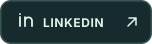</a>
  
  

 

## 01 / A little about me

I'm **A.R.K. Praneet**, a full-stack developer from India who enjoys the space where thoughtful design meets good engineering. From polished interfaces to the systems behind them, I like building practical things, exploring new technologies, and learning how it all works.

**My approach:** stay curious, make it useful, and enjoy the process.

 

## 02 / Selected work

A few things I've built, from everyday tools to the stuff under the hood.

<table width="100%">
  <tr>
    <td width="92" align="center"><a href="https://github.com/arkp1/paste-it">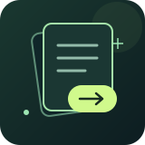</a></td>
    <td>
      <strong><a href="https://github.com/arkp1/paste-it">Paste it</a></strong> 
      Share text through unlisted links that can expire by time or view count. 
      NEXT.JS · TYPESCRIPT &nbsp; <a href="https://paste-it-eight.vercel.app/">LIVE&nbsp;DEMO&nbsp;↗</a>
    </td>
  </tr>
  <tr>
    <td width="92" align="center"></td>
    <td>
      <strong><a href="https://github.com/arkp1/RevPlay-P2">RevPlay</a></strong> 
      A full-stack music streaming app with playlists, podcasts, and artist analytics. 
      JAVA · SPRING BOOT · MYSQL
    </td>
  </tr>
  <tr>
    <td width="92" align="center"><a href="https://github.com/arkp1/image-compressor">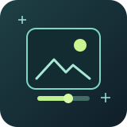</a></td>
    <td>
      <strong><a href="https://github.com/arkp1/image-compressor">Image Compressor</a></strong> 
      A simple image compressor with adjustable quality and a clean interface. 
      NEXT.JS · PYTHON · TAILWIND&nbsp;CSS &nbsp; <a href="https://compressit-puce.vercel.app/">LIVE&nbsp;DEMO&nbsp;↗</a>
    </td>
  </tr>
  <tr>
    <td width="92" align="center"></td>
    <td>
      <strong><a href="https://github.com/arkp1/http-server">HTTP Server</a></strong> 
      An HTTP server built from scratch to explore sockets and the web's foundations. 
      C++ · NETWORKING
    </td>
  </tr>
</table>

**[Explore all my repositories →](https://github.com/arkp1?tab=repositories)**

 

## 03 / The toolkit

**Interfaces**

  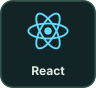
  
  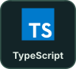
  
  
  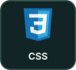
  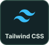
  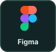

**Behind the scenes**

  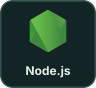
  
  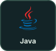
  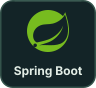
  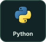
  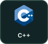

**Data**

  
  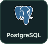
  

<!-- Toolkit artwork is adapted from Devicon; see assets/toolkit/NOTICE.txt. -->

 

## 04 / Let's connect

Have an idea, a question, or something cool to build? [Say hello](mailto:praneet2656@gmail.com) or take a look at [my portfolio](https://praneet-ark.vercel.app/). I'm always happy to connect with people who love making things.

BUILD WITH CURIOSITY &nbsp; ✦ &nbsp; KEEP LEARNING

